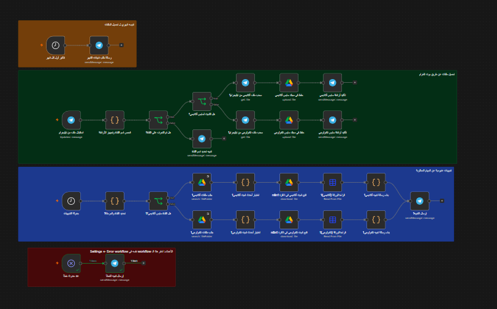
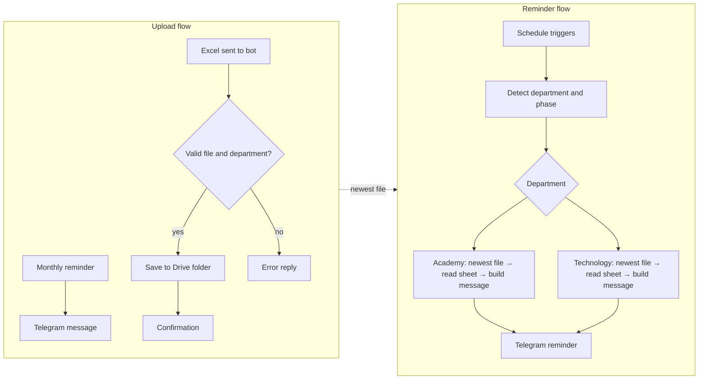
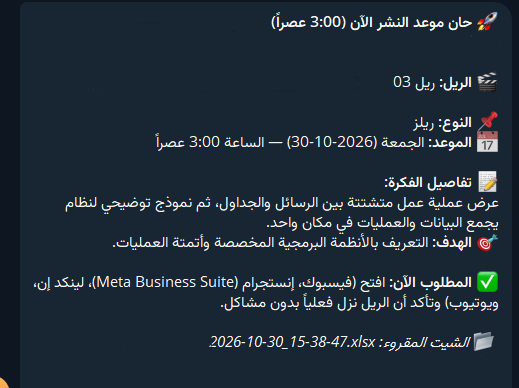
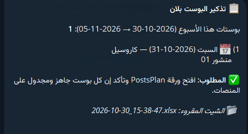

# 📅 Content Plan Reminder Bot (n8n + Telegram + Google Drive)

> A rule-based automation that keeps a social media team on schedule: it collects monthly content plans from Excel files, archives them in Google Drive, and sends **daily Telegram reminders with exactly what needs to be published today**.

No AI agents. No LLMs. No hallucinations. Just solid, predictable low-code automation.

> **Note:** This repository documents the idea and architecture only. The workflow source code is kept in a private repository.

---

## 🎯 The problem

Two departments (an *Academy* channel and a *Technology* channel) publish short videos (Reels) and posts on a fixed weekly schedule across Facebook, Instagram, LinkedIn and YouTube. The plan lives in an Excel sheet that changes every month. People forget to check the schedule, miss publishing windows, or work from an outdated sheet.

## ✅ The solution

A single n8n workflow that:

1. **Asks** for the new month's plans on the 1st of every month.
2. **Receives and archives** the Excel files sent through a Telegram bot.
3. **Reads the newest plan** at the right time and **reminds** the team about today's tasks.

---

## 🧩 How it works

### 1️⃣ Monthly reminder
On the 1st of every month, the bot sends a Telegram message asking for the new plan files and explaining how to label them.

### 2️⃣ Reception & archiving
- Files are sent to the bot with a short caption identifying the department.
- The bot validates the message: only the owner's chat is accepted, the file must be `.xlsx`, and the department must be recognized (otherwise it replies with a clear error).
- The file is saved to that department's **own Google Drive folder** with a timestamped name.
- Older files are **never deleted**. They stay in the folder as an archive.
- A confirmation message summarizes the saved file and the department's schedule.

### 3️⃣ Smart retrieval & daily reminders
- Each department has its own schedule triggers (see below).
- When a trigger fires, the workflow lists the department's folder and always **selects the newest file by creation time**.
- It downloads the file, reads the right sheet, finds the columns **by their header names** (not by fixed positions), and normalizes dates from many formats.
- It builds a message and sends it to Telegram.

---

## ⏰ Reminder types

| Type | When | What it does |
|---|---|---|
| **Pre-publish alert** | 30 minutes before the publishing time | Shows today's reel and asks the team to check that it is scheduled on all platforms |
| **Publish-time alert** | At the publishing time | Asks the team to confirm the reel actually went live |
| **Weekly post plan** | Once a week, 10:00 AM | Lists all posts planned for the next 7 days |

Each department has its own days and publishing time.

### Example messages

| Reel reminder | Weekly post plan |
|---|---|
|  |  |

---

## 📄 Expected Excel format

Each file contains two sheets: one for **Reels** and one for **Posts**. The workflow locates columns by header text, so column order does not matter:

| Header contains | Used for |
|---|---|
| `تاريخ النشر` (publish date) | Matching rows to today / the coming week |
| `اليوم` (day) | Day label in the message |
| `نوع` (type) | Content type |
| `عنوان` (title) | Reel / post title |
| `وصف` (description) | Idea details (reels) |
| `الهدف` (goal) | Optional goal line (reels) |

Dates can be real Excel dates, ISO text, or `d/m/y` / `m/d/y` text. The workflow normalizes them.

---

## 🛡️ Design decisions

- **Deterministic by design.** Same input, same output. Easy to debug and trust.
- **Newest file wins.** No manual "set active file" step. Upload a new sheet and it is used automatically.
- **Archive, don't overwrite.** Every upload gets a timestamped name.
- **Header-based parsing + date normalization.** Real-world spreadsheets are messy. The parser tolerates that.
- **Access control.** The bot ignores everyone except the owner.
- **No silent failures.** If something breaks (empty folder, Drive error, bad sheet), a Telegram alert is sent via an error workflow instead of the reminder just not arriving.
- **Predictable cost.** Runs on a self-hosted or cloud n8n instance with no per-token fees.

---

## 🛠️ Tech stack

- [n8n](https://n8n.io): workflow automation
- Telegram Bot API: input and notifications
- Google Drive API: storage and archive
- Excel (`.xlsx`): content plans
- JavaScript (n8n Code nodes): validation, parsing, message building

---

## 🤔 Why not an AI agent?

The task is a fixed schedule + structured data + a known message format. A rules-based workflow is cheaper, faster, and doesn't make things up. AI agents shine when the input is open-ended or needs judgment, not when the job is "read row, send reminder".

---

## 📬 Contact

Questions or ideas? Open an issue or reach out on LinkedIn.
